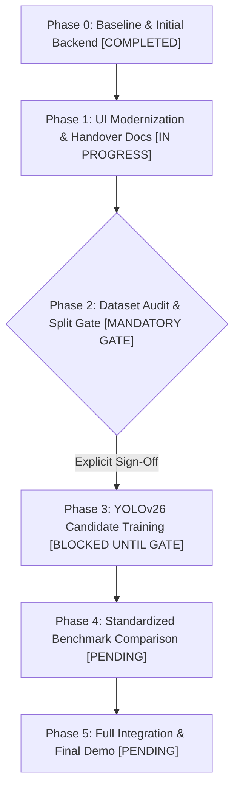

# BiomedicalWasteAI — Technical Roadmap & Milestone Execution Plan

**Document Version:** 2.0  
**Last Updated:** 2026-10-19  
**Status:** Baseline Audited & Verified • UI Refinement & Dataset Gate In Progress  

---

## 1. Executive Status & Milestone Tracker

This roadmap outlines the sequential, phased progression of the **BiomedicalWasteAI** project. It enforces strict audit gates between phases to ensure dataset integrity, prevents unverified claims, and standardizes candidate model experimentation (such as YOLOv26) against the verified YOLOv11n baseline.

### Quick Status Dashboard

| Phase | Milestone | Status | Lead Role | Primary Deliverable |
|:---|:---|:---:|:---|:---|
| **Phase 0** | Baseline Model & Initial Backend | **COMPLETED** | Original Developer / Antigravity | Verified YOLOv11n (`models/best.pt`), functional API, 12-image smoke test |
| **Phase 1** | UI Modernization, Documentation & Handover | **IN PROGRESS** | UI & Documentation Owner | React / Next.js web application, complete docs package, GitHub staging |
| **Phase 2** | Dataset Audit, Leakage Verification & Gate | **AWAITING APPROVAL** | Dataset Audit Owner | Independent audit of `dataset_balanced_v2/`, leak check, signed split protocol |
| **Phase 3** | YOLOv26 Experimental Candidate Training | **BLOCKED** | Model Experiment Owner | Feasibility audit, isolated candidate training, `models/yolov26_candidate.pt` |
| **Phase 4** | Standardized Comparative Benchmarking | **PENDING** | Evaluation & Documentation Owner | Side-by-side per-class mAP, recall, precision, CPU latency report |
| **Phase 5** | Application Integration & Final Demo | **PENDING** | Team / Demo Lead | Live interactive dashboard, presentation deck, project handover |

---

## 2. Phase 0: Baseline Development & Model Verification — `[COMPLETED]`

- **Goal:** Establish a verified, reproducible technical baseline for YOLOv11n biomedical waste detection.
- **Accomplished & Verified:**
  - Custom YOLOv11n model trained for 14 biomedical waste categories preserved at `models/best.pt` (5.22 MB).
  - Exact 14-class index order verified against `dataset/data.yaml` and `src/predict.py`.
  - Python HTTP server implemented in `app.py`, healthy and listening on port `7860`.
  - Core API endpoints operational: `/`, `/api/info`, `/api/metrics`, `/api/sample/<file>`, and `/api/predict`.
  - Programmatic Anti-COCO fallback guard active in `src/predict.py` (strictly prohibits generic 80-class weights).
  - 12-image functional smoke test executed on CPU (`conf=0.25`, `iou=0.45`): 10/12 plausible detections, 2 misclassifications identified (`gauze` $\rightarrow$ `plastic`, `glass` $\rightarrow$ `test tube`), steady-state CPU latency ~83–109 ms.
  - Original dataset `dataset/` (5,319 images) preserved completely untouched.
  - Backup checkpoint established at `models/best_new_backup.pt`.

---

## 3. Phase 1: UI Modernization, Documentation & GitHub Handover — `[IN PROGRESS]`

- **Goal:** Upgrade the user interface from basic static templates to a modern, component-driven web application and finalize repository documentation for team handover.
- **Key Tasks:**
  1. **Frontend Modernization (React / Next.js / Modern Component Stack):**
     - Transition the frontend from basic vanilla templates to a modular web application framework (e.g., Next.js or React with Vite).
     - Componentize core views:
       - `ImageDropzone`: Drag-and-drop, clipboard paste, resolution inspection, and error handling.
       - `DualImageViewer`: Side-by-side / split slider comparing Original Input vs. Annotated Detections.
       - `ThresholdControls`: Interactive confidence (0.10–0.90) and IoU threshold sliders with live re-inference.
       - `SegregationCards`: Standardized 4-bin hospital waste guidance (Yellow, Red, White Sharps, Blue Box) with CPCB/WHO disposal protocols.
       - `WebcamStream`: Browser MediaDevices camera stream with live canvas bounding-box overlays and freeze-frame capability.
       - `CategoryExplorer`: Dynamic 14-class catalog queried from `/api/info`.
     - Implement clean healthcare and environmental sustainability styling (emerald `#059669` and teal accents, responsive light mode, accessible typography).
  2. **Privacy & System Detail Sanitization:**
     - Remove all machine-specific personal directories, usernames, and raw hardware CPU markers from user-facing screens and metadata APIs.
  3. **Documentation Suite:**
     - Finalize `README.md`, `docs/PROJECT_STATUS.md`, `docs/ROADMAP.md`, and `docs/TEAM_TASKS.md`.
  4. **GitHub Handover Preparation:**
     - Verify `.gitignore` excludes `.venv/`, raw dataset images, and large runs.
     - Prepare clean commit structure (await user approval before any Git push).
- **Owner:** UI & Application Testing Owner (Frontend Lead)
- **Deliverables:** Modern component-based web interface, verified API integration test suite, complete documentation package.

---

## 4. Phase 2: Dataset Audit & Split Protocol Gate — `[MANDATORY APPROVAL GATE]`

- **Goal:** Rigorously verify dataset integrity, eliminate leakage risks, and formally approve a single dataset split before ANY new model training.
- **Mandatory Audit Checks (Do NOT Assume Clean):**
  1. **Independent Verification of `dataset_balanced_v2/`:**
     - Inspect `scripts/prepare_balanced_dataset_v2.py`, `scripts/audit_dataset_balanced_v2.py`, and `runs/phase5a_dataset_v2_audit_report.json`.
     - Independently re-verify image-label pairing, YOLO label bounding-box ranges ($[0, 1]$ normalization), and exact class IDs (0–13).
     - Verify that source image assignments between train, validation, and test are strictly disjoint using SHA-256 and perceptual hashing.
     - Confirm that all synthetic augmentations were derived exclusively from training scenes and have zero descendants in validation or test.
  2. **Formal Decommissioning of `dataset_balanced/`:**
     - Flag `dataset_balanced/` as deprecated due to previously identified train-validation leakage; prohibit its use in any training run.
  3. **Handling of Rare Class Imbalance:**
     - Acknowledge that in original `dataset/`, `scrub` has 0 validation instances and `glass` has only 2.
     - Confirm whether `dataset_balanced_v2/` provides valid, independent validation instances for `scrub` without synthetic leakage.
  4. **Test Split Exposure Disclosure:**
     - The existing 287-image test split was previously utilized during Phase 4 inference-tuning sweeps.
     - **Recommendation:** Partition a fresh, uncontaminated held-out test set if feasible.
     - **Limitation Disclosure:** If an untouched split cannot be constructed, explicitly document that test-split comparisons reflect a previously tuned distribution.
  5. **Explicit Gate Sign-Off:**
     - Training cannot proceed until the dataset audit report is verified and approved.
- **Owner:** Dataset Audit Owner
- **Deliverables:** `reports/dataset_audit_report.json`, signed `docs/DATASET_APPROVAL_GATE.md`.

---

## 5. Phase 3: YOLOv26 Candidate Experimentation — `[BLOCKED UNTIL PHASE 2 GATE]`

- **Goal:** Explore an experimental candidate architecture (YOLOv26 or chosen alternative) under strict scientific controls.
- **Key Principles & Tasks:**
  1. **Experimental Status:**
     - Treat YOLOv26 as an unverified experimental candidate, NOT a guaranteed performance improvement.
  2. **Tooling & Compatibility Verification:**
     - Verify repository stability, dependency requirements, and PyTorch/CUDA version compatibility on a dedicated GPU workstation.
     - Confirm native support for custom 14-class detection with identical class index mapping.
  3. **Checkpoint Preservation:**
     - `models/best.pt` (YOLOv11n) must remain locked and untouched.
     - Save all candidate training checkpoints to an isolated directory (e.g., `models/yolov26_candidate.pt` or `runs/detect/yolov26_experiment/`).
  4. **Training Protocol:**
     - Train strictly on the dataset split approved in Phase 2.
     - Standardize input resolution ($640 \times 640$) and training hyperparameters.
     - Use **validation data exclusively** for model selection, early stopping, and hyperparameter tuning. Never tune on test data.
- **Owner:** YOLOv26 Experiment Owner
- **Deliverables:** Tooling feasibility report, training logs (loss curves, mAP progression, Box-F1), candidate checkpoint `models/yolov26_candidate.pt`.

---

## 6. Phase 4: Standardized Benchmark Comparison & Evaluation — `[PENDING]`

- **Goal:** Perform an unbiased, protocol-aligned comparative evaluation pitting YOLOv11n against the candidate.
- **Standardized Evaluation Protocol:**
  - **Identical 14 Classes:** Class indices 0–13 must match exactly across both models.
  - **Identical Evaluation Split:** Evaluated on the exact same held-out test split under identical conditions.
  - **Identical Inference Parameters:** Resolution ($640 \times 640$), Confidence ($0.25$), NMS IoU ($0.45$).
- **Comparative Metrics Matrix:**

| Evaluation Dimension | Metrics Tracked | Target Comparison |
|:---|:---|:---|
| **Overall Detection Accuracy** | mAP@50, mAP@50–95 | Baseline (93.9% reported) vs. Candidate |
| **Detection Reliability** | Overall Precision, Overall Recall | Baseline (89.7% P / 91.7% R reported) vs. Candidate |
| **Per-Class Granularity** | Class AP across all 14 categories | Focus on rare classes (`scrub`, `glass`) and ambiguous classes (`gauze`, `plastic`, `tube`) |
| **Computational Footprint** | Model file size (MB), Parameter count | Baseline (5.22 MB, 2.6M params) vs. Candidate |
| **Inference Latency** | Mean CPU latency (ms/image over $\ge 100$ runs) | Baseline (~83–109 ms CPU) vs. Candidate |

- **Qualitative Failure Diagnosis:**
  - Side-by-side visual comparison of false positives, false alarms, and missed detections on challenging clinical scenes.
- **Owner:** Evaluation & Documentation Owner
- **Deliverables:** `docs/MODEL_COMPARISON_REPORT.md`, comparative confusion matrices, PR curves, and latency benchmarks.

---

## 7. Phase 5: Application Integration, Final Demo & Handover — `[PENDING]`

- **Goal:** Integrate the best-performing model into the modernized web application and deliver the final project presentation.
- **Key Tasks:**
  1. **Dynamic Model Plug-and-Play:**
     - Enable seamless model switching in the application backend via CLI (e.g., `python app.py --weights models/yolov26_candidate.pt`).
  2. **End-to-End System Testing:**
     - Validate full user journey: drag-and-drop upload, dual-preview rendering, threshold sliders, webcam stream, and CPCB segregation advice.
  3. **Academic Presentation & Demonstration:**
     - Prepare presentation slide deck outlining motivation, dataset challenges, baseline verification, candidate experimentation, and live demonstration.
     - Record high-resolution demonstration video walking through real-time waste classification.
- **Owner:** Team / Demonstration Lead
- **Deliverables:** Production-ready web dashboard, project presentation slide deck, recorded demo walkthrough, final project archive.
